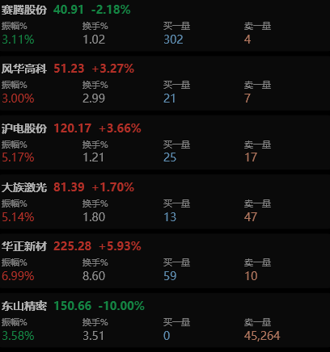
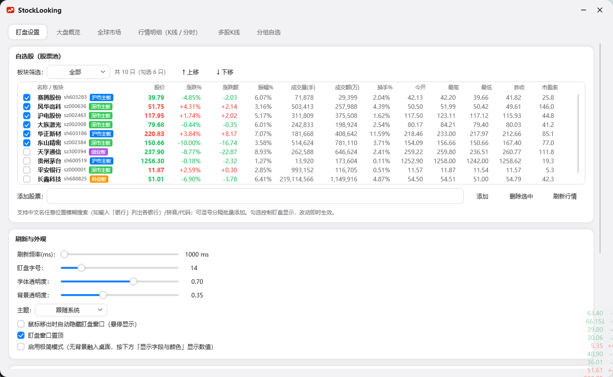
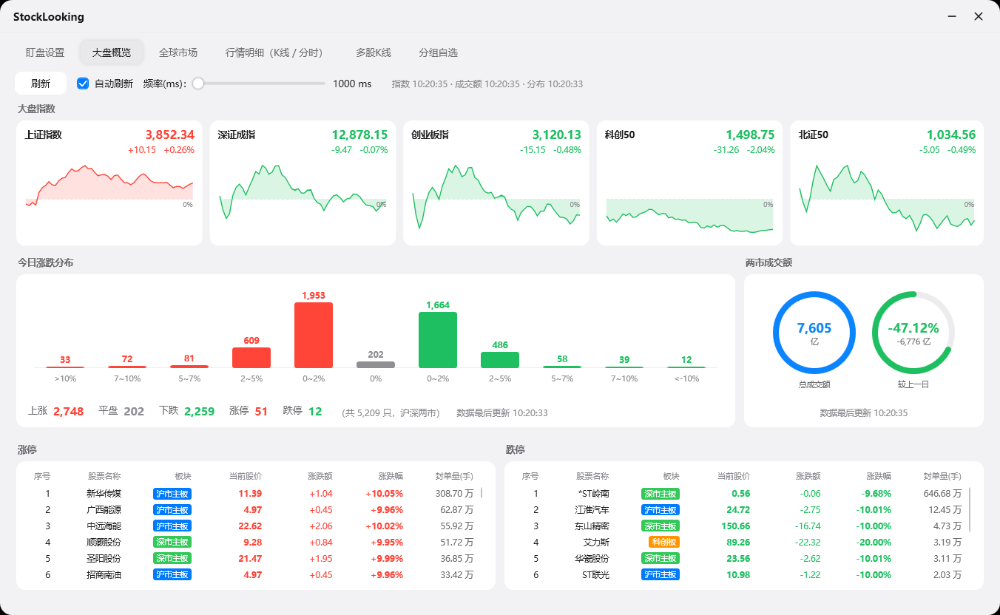
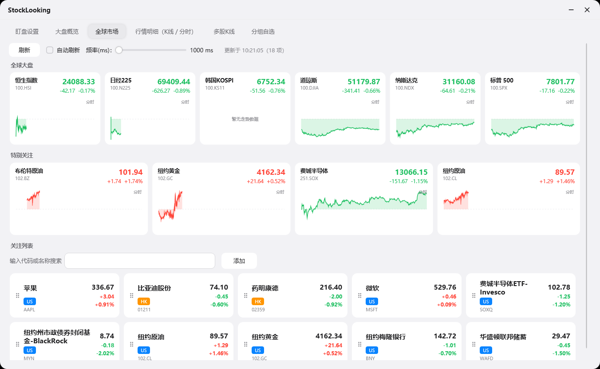
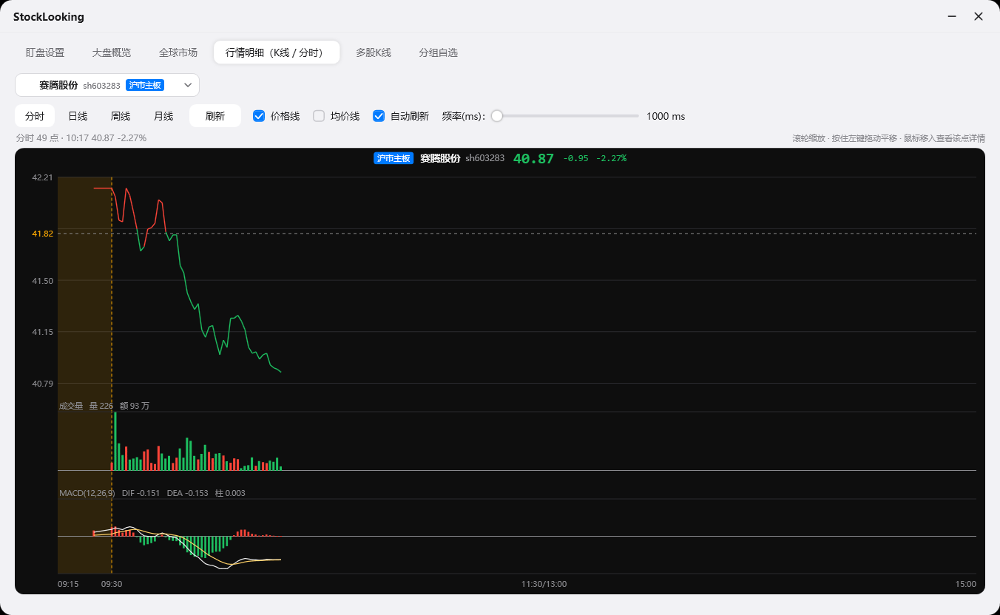
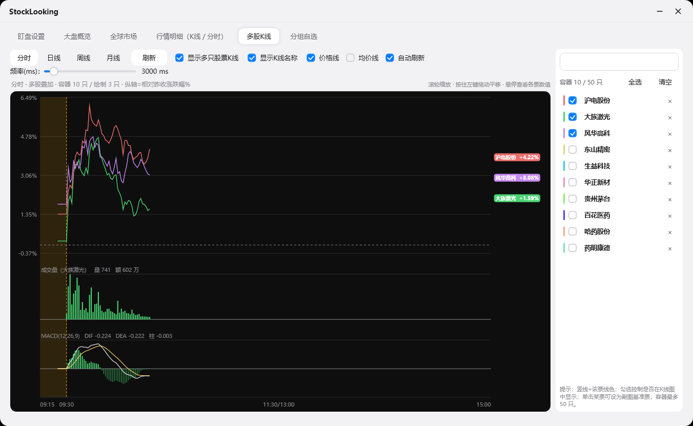
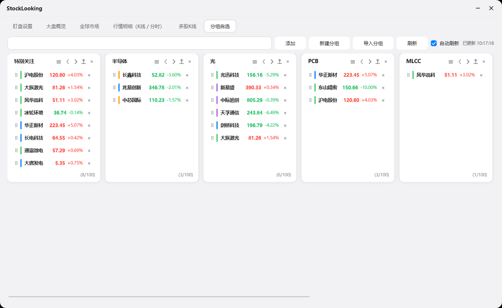

# StockLooking.wpf

一款 Windows 桌面**个人盯盘工具**（C# / .NET 8 / WPF），面向 A 股散户的日常盯盘场景：
桌面常驻的**盯盘浮窗** + 主窗口里的**大盘概览 / 全球市场 / K 线明细 / 多股叠加 / 分组自选**，
全部数据来自免费公开行情接口（腾讯 / 东方财富 / 新浪），无需注册、无需 Token。

> 支持 深色 / 浅色 / 跟随系统 三态主题，Apple 风格圆角卡片 UI，无边框自绘窗口。

   

---

## 目录

- [功能总览](#功能总览)
- [界面速览](#界面速览)
- [编译与运行](#编译与运行)
  - [打包发布](#打包发布)
- [使用指南](#使用指南)
- [项目结构](#项目结构)
- [架构与数据源](#架构与数据源)
- [配置文件](#配置文件)
- [实现要点](#实现要点)
- [常见问题](#常见问题)
- [免责声明](#免责声明)

---

## 功能总览

| 模块 | 能力 |
|---|---|
| **盯盘浮窗** | 桌面常驻、置顶、无边框小窗；逐股卡片显示名称 / 股价 / 涨跌幅等字段；快速涨跌箭头；按住卡片手柄拖拽排序（FLIP 动画）；双击隐藏；可开启「鼠标移出自动隐藏」「极简模式（全透明融入桌面）」 |
| **盯盘设置** | 自选股股票池：中文/拼音/代码模糊搜索添加、批量添加、板块筛选、上移下移与拖拽排序、勾选控制浮窗显示；刷新频率 / 字号 / 字体透明度 / 背景透明度 / 主题 / 置顶等外观设置；22 个字段的显隐与颜色（固定色 / 涨红跌绿）逐项配置 |
| **大盘概览** | 上证指数 / 深证成指 / 创业板指 / 科创50 / 北证50 五张迷你 K 线卡片；全市场涨跌分布柱状图（上涨/平盘/下跌/涨停/跌停家数）；两市成交额圆环（总额 + 较上一日）；涨停 / 跌停明细表（含封单量） |
| **全球市场** | 恒生指数 / 日经225 / 韩国KOSPI / 道琼斯 / 纳斯达克 / 标普500 分时卡片；「特别关注」栏（默认原油 / 黄金 / 费城半导体，可右键增删）；外围标的关注列表（美股 / 港股 / 台股 / 日韩指数 / 外盘商品），双击弹 K 线 |
| **行情明细** | 单只个股 分时 / 日线 / 周线 / 月线；主图 + 成交量副图 + MACD 副图；价格线 / 均价线显隐；滚轮缩放、左键拖动平移、十字光标悬停详情（含该日分时迷你图）；双击某根 K 线弹出该日分钟级走势 |
| **多股K线** | 右侧容器最多 50 只票，K 线 / 分时同图叠加对比；勾选控制显隐、K 线末端名称标签、单击设为副图基准票；独立自动刷新频率 |
| **分组自选** | 同花顺式分组卡片：新建 / 重命名 / 删除 / 前移后移；组内按涨跌幅一键排序（涨幅优先 → 跌幅优先 → 加入顺序 三档循环）；分组导出 / 导入（`.sl` 文件）；组内拖拽排序；双击弹出 K 线 |
| **系统托盘** | 显示/隐藏盯盘窗口（勾选项）、极简模式开关、打开主窗口、退出；左键单击托盘图标即切换盯盘窗口；右键菜单为 Apple 风（与全局右键菜单同套样式，明暗主题自适应） |
| **主题** | 跟随系统 / 浅色 / 深色，切换实时生效（动态资源字典换肤） |

---

## 界面速览

### 盯盘浮窗（桌面常驻）

启动后默认只显示盯盘浮窗（贴屏幕右下角），主窗口按需打开。每只勾选的股票一张卡片，
单次刷新价格变动超过阈值（默认 0.3%）时显示 ▲/▼ 快速涨跌箭头。



### 主窗口 · 盯盘设置

自选股股票池 + 刷新与外观 + 显示字段与颜色，所有改动即时生效并自动保存。



### 主窗口 · 大盘概览

五大指数卡片（迷你分时） + 全市场涨跌分布 + 两市成交额圆环 + 涨停/跌停明细，一页看完全市场情绪。



### 主窗口 · 全球市场

全球大盘指数 + 特别关注（商品/产业） + 外围标的关注列表，A股开盘前看隔夜外围。



### 主窗口 · 行情明细（K线 / 分时）

单股 K 线 / 分时，主图 + 成交量 + MACD 三段同屏，支持缩放 / 平移 / 悬停详情。



### 主窗口 · 多股K线

多只个股同图叠加对比（按涨跌幅归一），右侧容器管理参与对比的股票。



### 主窗口 · 分组自选

同花顺式分组卡片，横向排布，支持导入 / 导出与组内拖拽排序。



---

## 编译与运行

### 环境要求

- Windows 10 / 11
- [.NET 8 SDK](https://dotnet.microsoft.com/download/dotnet/8.0)（`net8.0-windows`）

### 命令行

```bash
# 还原 + 编译（交付标准：0 警告 0 错误）
dotnet build -c Debug

# 直接运行
dotnet run --project StockLooking.wpf
```

### Visual Studio

打开 `StockLooking.wpf.sln`，`F5` 即可。可执行文件输出在
`StockLooking.wpf\bin\Debug\net8.0-windows\` 下（文件名由 csproj 的 `AssemblyName` 决定，当前为 `StockLooking.exe`）。

### 打包发布

推荐发布为**独立单文件**形态 —— 产出单个 `StockLooking.exe`，目标机无需安装 .NET 运行时，双击即用：

```bash
cd StockLooking.wpf

dotnet publish -c Release -r win-x64 --self-contained true ^
  -p:PublishSingleFile=true ^
  -p:IncludeNativeLibrariesForSelfExtract=true ^
  -p:DebugType=none ^
  -o "D:\1 Harri\0 Learn\Publish"
```

| 参数 | 作用 |
|---|---|
| `-r win-x64` | 目标平台，必须指定否则无法独立部署 |
| `--self-contained true` | 自带 .NET 8 运行时 + WindowsDesktop（WPF/WinForms），目标机免安装 |
| `PublishSingleFile` | 全部托管 dll 打进一个 exe |
| `IncludeNativeLibrariesForSelfExtract` | **WPF 必需**：把 `wpfgfx_cor3.dll`、`PresentationNative_cor3.dll` 等原生库也打进 exe，否则它们会散落在 exe 旁边 |
| `DebugType=none` | 不产出 `.pdb`，发布目录更干净 |

产物：单个 `StockLooking.exe` ≈ 156 MB（未启用裁剪，WPF 反射较多不宜裁剪），7z 极限压缩后约 **45 MB**。
首次启动会向 `%TEMP%\.net\` 释放原生库，耗时约 1~2 秒，之后启动正常。

> 若是在已装 [.NET 8 Windows Desktop Runtime](https://dotnet.microsoft.com/download/dotnet/8.0) 的机器上自用，
> 可改用 `--self-contained false`，产物仅约 1~3 MB，但需要目标机安装运行时。
> 程序为绿色单实例运行，不写注册表、不安装服务；配置保存在
> `%LocalAppData%\StockLooking\settings.json`，删除该目录即恢复出厂状态。

---

## 使用指南

### 1. 盯盘浮窗

- **拖动窗口**：按住浮窗任意空白处拖动（极简模式下也可靠，见实现要点）。
- **调整卡片顺序**：按住卡片右侧的拖拽手柄上下拖动，其它卡片让位动画跟随，顺序即时持久化。
- **隐藏**：双击浮窗；或取消托盘菜单「显示盯盘窗口」的勾选。
- **悬停自动隐藏**：在「盯盘设置」勾选后，鼠标移出浮窗即隐藏、移入自动显示。
- **极简模式**：只显示股价 + 涨跌幅、无卡片背景，完全融入桌面；托盘菜单与设置页均可开关。

### 2. 添加自选股

「盯盘设置 → 添加股票」输入框支持：

- 代码：`600519` / `sz000001`（自动补市场前缀）
- 中文名任意位置模糊匹配：输入「银行」可列出各银行（本地全量名录 + 腾讯 smartbox 拼音/前缀提示）
- 逗号分隔批量添加：`600519,000001,300750`

**勾选**决定该股是否出现在盯盘浮窗；「上移 / 下移」按钮与行尾拖拽手柄均可调整顺序。

### 3. 自动刷新的门控

自动刷新是**页面级**开关：切到某页时自动勾上该页、离开即取消，避免后台空转打接口。
各页刷新频率独立配置（行情明细 / 多股K线 / 大盘概览 / 全球市场各一个滑块，步进 1000ms）。

### 4. 分组自选的导入导出

- **导出**：卡片右上角导出图标，导出为 `.sl`（JSON）文件；
- **导入**：顶部「导入分组」，导入前可重命名，重名分组必须改名后才能导入。

### 5. K 线交互

| 操作 | 效果 |
|---|---|
| 滚轮 | 缩放可见根数 |
| 按住左键拖动 | 平移 |
| 鼠标悬停 | 十字光标 + 该点全部信息（日/周/月线附该日分时迷你图） |
| 双击某根 K 线 | 弹出该日分钟级走势（近 5 日逐分钟；更早按分钟 K 线还原并如实标注粒度，最远约 370 天） |

---

## 项目结构

```
StockLooking.wpf/
├─ StockLooking.wpf.sln
├─ stock-up.ico
└─ StockLooking.wpf/
   ├─ App.xaml / App.xaml.cs        # 应用入口：全局样式、托盘、窗口编排、名录预热
   ├─ Models/                       # 数据模型（AppSettings / WatchRow / MarketIndex / ...）
   ├─ Services/                     # 行情客户端与业务服务（无 UI 依赖）
   │  ├─ TencentStockClient.cs      #   腾讯快照 qt.gtimg.cn（批量报价 / smartbox 搜索）
   │  ├─ EastMoneyClient.cs         #   东财 K线 / 分时 / 全球指数 / 外盘期货
   │  ├─ SinaKlineClient.cs         #   新浪分钟 K 线（历史分时还原）
   │  ├─ GlobalMarketService.cs     #   全球大盘 / 外围个股
   │  ├─ MarketBreadthService.cs    #   全市场涨跌分布 / 两市成交额 / 涨跌停明细
   │  ├─ StockCatalog.cs            #   A 股全量名录（东财主源 + 新浪兜底，搜索用）
   │  ├─ StockSearchService.cs      #   搜索统一入口（本地名录 ∪ smartbox，去重）
   │  ├─ DayTrendService.cs         #   某日分钟级走势（多源回退 + 粒度自适应）
   │  ├─ MacdCalculator.cs          #   MACD（通达信口径，含分时预热）
   │  ├─ CandleBatch.cs             #   蜡烛图批量绘制（StreamGeometry 合并）
   │  ├─ SettingsService.cs         #   配置持久化 + 兜底修复
   │  ├─ ThemeManager.cs            #   明暗主题切换
   │  └─ TrayIconService.cs         #   托盘图标与菜单
   ├─ Views/                        # 窗口与控件
   │  ├─ MainWindow.*               #   主窗口（六个分页）
   │  ├─ MonitorWindow.*            #   盯盘浮窗
   │  ├─ MarketOverview.*           #   大盘概览页
   │  ├─ GlobalMarketView.*         #   全球市场页
   │  ├─ KlineChart.*               #   K线/分时图控件（明细页与弹窗共用）
   │  ├─ MultiKlineChart.*          #   多股K线页
   │  ├─ KlineWindow / TrendWindow  #   K线弹窗 / 某日分时弹窗
   │  └─ StockSearchBox / AppDialog / GroupNameDialog
   ├─ Themes/Dark.xaml · Light.xaml # 主题资源字典
   └─ Converters/                   # 值转换器
```

**分层约定**：`Models`（纯数据） ← `Services`（网络 / 计算 / 持久化，不依赖 UI） ← `Views`（界面）。
窗口之间不互相持有引用，统一由 `App.xaml.cs` 编排；配置只有一份 `AppSettings` 实例在窗口间共享。

---

## 架构与数据源

### 数据源（全部为免费公开接口，多源互备）

| 用途 | 主源 | 备源 |
|---|---|---|
| A 股实时快照（批量报价） | 腾讯 `qt.gtimg.cn`（GBK，`~` 分隔） | — |
| 分时 / 日K / 周K / 月K | 腾讯 `ifzq.gtimg.cn` | 东方财富 `push2his` → 新浪 |
| 历史分钟线（分时还原） | 腾讯 `day/query`（近 5 日逐分钟） | 东财 `trends2` → 新浪分钟 K 线 |
| 全球指数 / 外盘商品 | 东方财富 `push2his`（secid 直传） | 新浪（`gb_sox` / 外盘期货 NK 等） |
| 全市场涨跌分布 / 成交额 | 东财 `push2`（全市场分页抓取） | — |
| 股票搜索 | 本地全量名录（子串匹配，任意位置可命中） | 腾讯 `smartbox`（拼音 / 前缀） |

要点：

- **A 股全量名录**（约 5900 只，含北交所）启动时后台预热、运行期每小时检查过期（6h）即静默刷新，
  保证长年不重启也能搜到新上市股票；
- **多源回退**：每个取数路径都做了主源失败 → 备源兜底，单一接口抖动不影响界面；
- **市场前缀映射**：配置键统一 `sh/sz` 形式（北交所历史约定归 `sz`），请求时再按接口要求改写
  `bj` 前缀；指数代码（如北证50 `bj899050`）原样直传，绝不走归一化规则；
- **分时时间轴**：按市场时段（A股 / 港股 / 美股 / 外盘期货 / 亚洲）配置，午休折叠，横轴不失真。

### 配置版本迁移

`AppSettings` 内置 `OverviewConfigVersion` 配置版本号：修改任何默认值时版本 +1，
`SettingsService.Normalize` 检测到版本落后即重置为新默认值，避免「旧默认值被当成用户设置永远生效」。

---

## 配置文件

路径：`%LocalAppData%\StockLooking\settings.json`（JSON，UTF-8）。关键字段：

| 字段 | 说明 | 默认 |
|---|---|---|
| `Stocks` | 自选股代码（`sh/sz` + 6 位数字），顺序即显示顺序 | `sh600519, sz000001` |
| `HiddenStocks` | 未勾选（不在浮窗显示）的股票 | 空 |
| `Fields` | 浮窗字段配置（22 项：显隐 / 显示名称 / 颜色模式 / 颜色） | 名称+股价+涨跌幅+振幅 |
| `RefreshIntervalMs` | 浮窗刷新间隔（ms），下限 1000 | 3000 |
| `FontSize` / `TextOpacity` / `BackgroundOpacity` | 浮窗字号 / 文字透明度 / 背景透明度 | 14 / 1.0 / 0.25 |
| `HoverToShow` / `AlwaysOnTop` / `MinimalMode` | 悬停自动隐藏 / 置顶 / 极简模式 | false / true / false |
| `FastMoveThreshold` | 快速涨跌箭头阈值（单次刷新涨跌占比） | 0.003 |
| `KlineType` / `KlineLimit` | K 线周期（intraday/101/102/103）与根数 | intraday / 120 |
| `KlineRefreshIntervalMs` / `MultiKlineRefreshIntervalMs` | 明细页 / 多股页刷新间隔 | 5000 / 3000 |
| `Groups` | 分组自选（组内仅存代码） | 空 |
| `MultiKlineStocks` / `MultiKlineHidden` / `MultiKlineEnabled` | 多股K线容器内容与开关 | 空 / 空 / true |
| `OverviewRefreshIntervalMs` | 大盘概览页刷新间隔 | 2000 |
| `GlobalRefreshIntervalMs` / `FavoriteItems` / `ForeignStocks` | 全球市场页刷新间隔 / 特别关注卡片 / 关注列表 | 3000 / 原油黄金费半 / 空 |
| `Theme` | 主题（System / Light / Dark） | System |

> 配置损坏时自动回退出厂默认；字段缺失（旧版本配置）由 `SettingsService.Normalize` 按默认字段表合并补齐。

---

## 实现要点

- **K 线渲染性能**：多股K线页 49 只 × 120 根 ≈ 1.2 万个 Canvas 子元素是卡顿主因。
  `CandleBatch` 把可见区间全部蜡烛合并成 ≤4 个 `StreamGeometry` 的 `Path`（每票），
  元素数下降两个数量级；十字光标单独一层（overlay），鼠标移动只重绘光标层。
- **FLIP 排序动画**：自选股列表 / 分组内列表 / 盯盘卡片三处拖拽排序共用同一套
  First–Last–Invert–Play 补间（280ms 正弦缓出），位移按「布局位置」计算，连续快速拖动不跳帧；
  数据用 `ObservableCollection.Move` 复用容器，不整表重建。
- **无边框窗口拖动**：盯盘浮窗不用 `DragMove()`（极简模式全透明下会失效），
  改为「起点绝对坐标 + 总位移」手动定位，并做物理像素 → WPF 逻辑单位（DIP）换算，高 DPI 下依然跟手。
- **页面级自动刷新**：切页时只勾当前页、取消其它页；每个定时器只在「主窗可见 + 停留本页 + 已勾选」
  时运行；重请求（全市场分布约 20 个批量请求）另有 3s / 10s 保护下限，避免触发对端限流。
- **MACD 口径**：与通达信一致（EMA 首值取序列首值）；分时 MACD 用「预热序列」拼接最近数个交易日
  分钟收盘价后再递推，消除开盘半小时的 EMA 失真。
- **历史分时不虚构**：免费源没有任意历史日的逐分钟分时，程序按「粒度 × 根数上限」自适应放粗
  （5 分钟 → 15 分钟 → 30 分钟 → 60 分钟），并在界面如实标注数据粒度与来源。
- **主题**：所有颜色走 `DynamicResource` 引用 `Themes/Dark.xaml` / `Light.xaml` 的画刷键，
  切换即实时换肤；K 线绘图区固定深色底，其上文字用固定浅色，避免浅色主题下不可读。

---

## 常见问题

**Q：能添加美股 / 港股到盯盘浮窗吗？**
不能。浮窗股票池仅支持 A 股（`sh/sz/bj` + 6 位数字）；美股 / 港股 / 商品请用「全球市场」页的关注列表。

**Q：启动后搜索框搜不到股票？**
全量名录首次启动需后台拉取（几秒），失败会自动退化为腾讯 smartbox 前缀/拼音搜索，功能不受影响。

**Q：收盘后 / 周末打开，数据是旧的吗？**
K 线 / 分布取接口最近数据，收盘后显示当日收盘结果；「上一交易日成交额」当天内固定缓存。

**Q：浮窗拖不动？**
极简模式下窗口间隙不参与命中测试是 WPF 正常行为，程序已内置全窗口透明遮罩兜底；
若仍异常，检查是否按在了卡片拖拽手柄上（手柄用于卡片排序，不拖动窗口）。

**Q：接口会不会被限流？**
已做节流：各页刷新下限 1000ms，全市场类请求另有保护下限与「残缺结果拒收」校验，正常使用不会触发。

---

## 免责声明

本项目仅用于个人学习与技术研究，行情数据来自第三方公开接口，**不构成任何投资建议**，
数据的及时性与准确性不作保证；请遵守各数据源的服务条款，勿用于商业用途。

## License

[MIT](LICENSE.txt)
